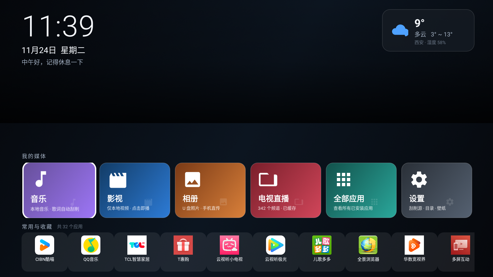
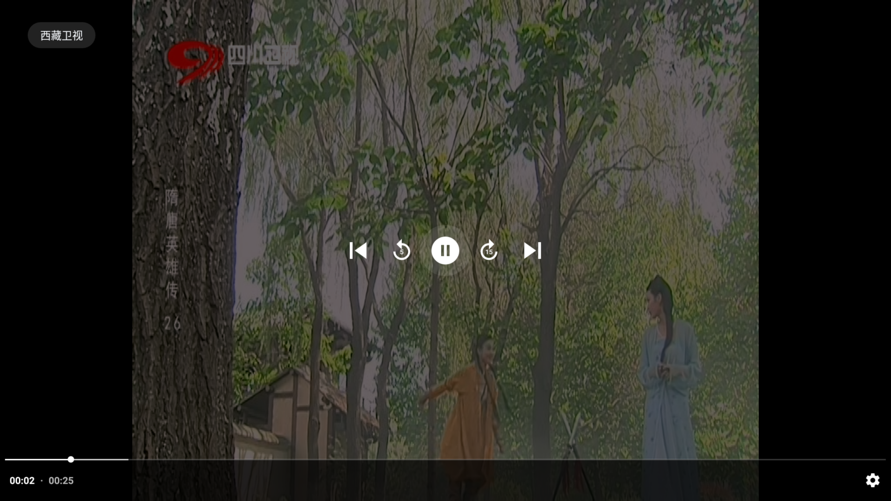
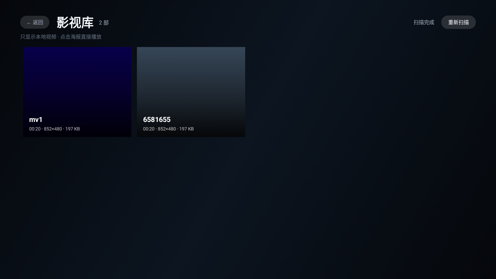

# 智慧家庭TV · Android 8 电视桌面

面向 Android 8（API 26）电视盒 / 智能电视的桌面与本地媒体中心：大时钟、按定位自动获取的天气、应用与网站收藏入口、本地音乐（自定义歌单 / 顺序随机播放 / 歌词同步）、只含本地视频且点击直接播放的影视库、读取配置 m3u / m3u8 的大屏电视直播频道墙、按拍摄日期分组的相册与手机网页直传、网页浏览器与迅雷链接下载。

参考 [pengchujin/aerial-tv](https://github.com/pengchujin/aerial-tv) 的清爽卡片式布局：深色渐变全屏、顶部大时钟与天气、6 张功能卡、下方「常用与收藏」横排、全部应用网格、可选视频壁纸。



## 已实现功能

| 模块 | 能力 |
| --- | --- |
| 桌面 | 时钟 / 日期 / 问候语；天气按系统定位或 IP 自动确定城市（Open-Meteo，30 分钟缓存，免 Key）；6 张功能卡；网站收藏 + 常用应用横排；全部应用网格（4/5/6 列可调）；D-pad 焦点放大与白描边；可选视频壁纸 |
| 音乐 | 扫描所有存储卷（可加自定义目录），支持 mp3 / flac / wav / aac / m4a / ogg / opus / wma / mka / ape；自定义歌单（新建 / 重命名 / 删除 / 长按加歌 / 移出）；顺序播放与随机播放可切换并持久化；ExoPlayer 播放、前后台切换、通知栏控制；封面与内嵌封面；LRC 时间轴自动高亮居中滚动 |
| 影视 | 只保留本地视频；4 列海报墙、抽帧海报、NFO / TMDB 刮削；点击海报直接进入播放页，不再进入详情页、不再询问播放器 |
| 电视直播 | 首页「电视直播」读取「设置 → 直播源」中配置的 m3u / m3u8，也自动发现 Download 目录中的源；独立大屏频道墙按分组展示全部频道，卡片显示台标、频道名、分组；点频道直接播放（HLS 用 ExoPlayer）；频道信息与台标图片会缓存到本地，下次打开先出缓存再后台刷新 |
| 相册 | 全盘图片 6 列网格；按实际拍摄日期分组（EXIF `DateTimeOriginal`/`DateTime` → 文件名日期 → 文件修改时间）；日期头显示星期与张数；全屏查看，OK 缩放、方向键平移、双指缩放；右上角「手机上传」 |
| 手机上传 | 内嵌 NanoHTTPD 服务（默认 `8686`，被占用自动 +1 重试）；手机浏览器打开 `http://电视IP:端口`，多选照片/视频逐个上传；写入 U 盘 `Photos` 目录（未检测到 U 盘时落到应用外部目录），重名自动加 `(1)`；单文件上限 300MB |
| 浏览器 | WebView 地址栏、前进后退、刷新；收藏当前网页后出现在首页「常用与收藏」最前面（最多 4 个，点击直达）；下载直链与迅雷 `thunder://`（Base64 解码、去 `AA`/`ZZ` 前缀后交给系统 DownloadManager 落到公共 Download 目录）；磁力链接给出不支持提示 |
| JPTV | 作为独立 APK 工具保留：默认包名 `tv.android.jianpian.com`（荐片）；在「设置 → 下载目录 · 安装包」中扫描 Download 目录 APK，确认后调系统安装器，已安装可直接启动；不再占用首页「电视直播」入口 |

## 界面预览

| 首页 | 电视直播频道墙 | 本地影视库 |
| --- | --- | --- |
|  |  |  |


## 技术栈

- Kotlin 2.0.21，AGP 8.7.3，Gradle 8.9，JDK 17 字节码（构建时用 JDK 17/21 运行 Gradle）
- `compileSdk 34`，`minSdk 26`，`targetSdk 28`（保持 Android 8 的存储与后台行为）
- 依赖：androidx.core、androidx.recyclerview、androidx.media3（exoplayer + hls + ui）、androidx.exifinterface、OkHttp、NanoHTTPD
- 无 AppCompat / Compose / Glide / Coil / 协程；图片加载器与线程池自带实现
- ViewBinding + 平台 `Theme.Material.NoActionBar`

## 构建

环境要求：JDK 17+、Android SDK Platform 34、Build-Tools 34.0.0。

```powershell
# 1. 配置 SDK 路径（已存在可跳过）
#    local.properties: sdk.dir=C:\\Users\\<你>\\AppData\\Local\\Android\\Sdk

# 2. 指定 JDK（AGP 8.x 不接受 JDK 8）
$env:JAVA_HOME = "C:\Users\liuji\.jdks\jbr-21.0.11"

# 3. 构建 debug APK
.\gradlew.bat assembleDebug
```

产物：`app\build\outputs\apk\debug\app-debug.apk`（仓库根目录另存了一份 `MyTV-1.2.0-debug.apk`）。

> `gradle-wrapper.properties` 指向腾讯云 Gradle 镜像；依赖仓库优先走阿里云镜像（见 `settings.gradle.kts`）。

安装到电视（ADB 调试已开启）：

```powershell
adb connect 电视IP:5555
adb install -r MyTV-1.2.0-debug.apk
```

### TCL / 雷鸟电视：只能作为普通应用安装

部分 TCL 固件会在解析 APK 时拒绝带 `android.intent.category.HOME` 的非 TCL 签名应用，报错：

```
INSTALL_PARSE_FAILED_INCONSISTENT_CERTIFICATES: disable install launcher app not signature by tcl
```

此类电视无法安装第三方桌面，`MyTV-1.2.0-debug.apk` 会被系统直接拒绝。仓库提供去掉 HOME 类别的普通应用变体：

```powershell
.\gradlew.bat assembleTvapp
adb install -r MyTV-1.2.0-tvapp.apk
```

- 包名 `com.mytv.launcher.tvapp`，显示名称仍是 MyTV，版本 1.2.0；
- 可以从电视「应用 / 全部应用」打开，功能完整；
- 不能设为默认桌面，按 Home 键仍回 TCL 桌面；
- 已在 TCL 电视（Android 8.0，型号 `sugarcane`）实测安装并启动成功。

## 首次使用

1. 打开 MyTV，授予「存储」与「位置」权限（位置权限只用于天气城市定位）。
2. 设为默认桌面：电视「设置 → 应用 → 默认应用 → 主屏幕」选择 MyTV；或执行
   ```powershell
   adb shell cmd package set-home-activity com.mytv.launcher/.ui.MainActivity
   ```
3. 首页天气默认自动定位：优先读取系统最后已知位置并反查城市，读不到再走 IP 定位；都失败时回退到手动城市「西安」。

## 各模块使用说明

### 天气定位

- 「设置 → 天气定位」默认开启；「重新定位」可立即刷新。
- 定位顺序：系统 GPS / Network / Passive 最后已知位置（30 天内）→ Geocoder 反查城市；否则 IP 定位（ip-api.com → ipapi.co）；结果缓存 24 小时。
- 手动修改「天气城市 / 纬度 / 经度」会关闭自动定位，改用固定坐标。

### 音乐

- 自动扫描内置存储与所有外接存储卷中的音频；也可以在「设置 → 音乐目录」填 `;` 分隔的目录。
- 选中曲目按 OK 播放；`上一首 / 播放暂停 / 下一首` 支持遥控器与通知栏。
- 歌单：顶部「我的歌单」查看列表，「新建歌单」输入名称；在「全部歌曲」或歌单内长按歌曲可加入其他歌单；长按歌单可重命名 / 删除；进入歌单后点「我的歌单」返回。歌单为空时会提示长按歌曲加入。
- 播放模式按钮在「顺序播放 / 随机播放」间切换，重启后保留。
- 歌词刮削：
  1. 音频同目录同名 `.lrc` 或同目录 `lyrics/<同名>.lrc`；
  2. 已刮削缓存 `files/lyrics/<hash>.lrc`；
  3. 网易云音乐搜索 + 歌词接口；
  4. LRCLIB。
- LRC 支持一行多时间标签、UTF-8 失败回退 GBK。

### 影视（仅本地视频）

- 只扫描本地视频，不再提供直播标签，也不再打开详情页。
- 点击海报直接进入全屏播放；同名 `.srt/.ass/.ssa/.vtt` 字幕自动挂载。
- 标题解析与刮削仍保留：文件名解析标题、年份、`SxxExx` / `第N季第N集`；刮削优先级为缓存 → 同目录 NFO → 同目录图片 → TMDB → 抽帧。
- 解码：ExoPlayer 默认优先使用系统硬件解码器（MediaCodec / Codec2，GPU 渲染）；初始化时开启 `setEnableDecoderFallback(true)`，硬解不可用时自动回退软解。
- NFO 示例（与视频同目录、同名 `.nfo`）：
  ```xml
  <movie>
    <title>流浪地球2</title>
    <plot>太阳危机下的人类自救。</plot>
    <year>2023</year>
    <rating>8.3</rating>
    <genre>科幻</genre>
    <poster>poster.jpg</poster>
    <fanart>fanart.jpg</fanart>
  </movie>
  ```
- 同目录放 `poster.jpg` / `fanart.jpg`（或 `folder.jpg`）即可离线显示海报与背景；TMDB Key 在「设置 → TMDB API Key」填入。

### 电视直播（大屏频道墙）

- 首页「电视直播」卡读取「设置 → 直播源」的配置，不再跳转 JPTV。
- 直播源一行填一个 m3u / m3u8 地址或本地路径；也支持自动识别 Download 目录中的 `.m3u` / `.m3u8`。
- 进入后先展示本地缓存，再后台刷新；按 `group-title` / `#EXTGRP` 分组，展示全部频道，卡片含台标、频道名、分组和分组数量。
- 解析 `#EXTINF`、`group-title`、`tvg-logo`，按分组和名称排序去重。
- 点频道直接进入 ExoPlayer 大屏播放，`.m3u8` 使用 HLS 数据源。
- 频道信息和台标 URL 持久化在本地（`live_channels`），台标图片下载到 `files/live_logos/<sha1>.img`；断网或重启后仍能先显示频道墙。
- 暂不支持 `rtmp://` / `rtsp://` 播放（未引入对应 ExoPlayer 扩展）；这类频道会出现在列表中但播放会报错。

### 相册 / 手机上传

- 相册按拍摄日期倒序分组，每组标题如「2023年5月4日 星期四 · 1 张」。
- 拍摄时间解析顺序：EXIF 原始拍摄时间 → 文件名中的 `20230504` / `2023-05-04` 等日期 → 文件修改时间；三者都取不到才归入文件时间对应日期。
- 手机上传：电视与手机连同一个 WiFi；相册页点「手机上传」，手机浏览器打开页面显示的 `http://电视IP:8686`，多选照片/视频上传；写入 U 盘 `Photos` 目录（无 U 盘时落应用外部目录），相册自动刷新。
- 支持格式：jpg / jpeg / png / gif / webp / bmp / heic / heif / mp4 / mov / 3gp / m4v。

### 浏览器 / 网站收藏 / 下载

- 入口：「设置 → 网页浏览器」；也可从首页收藏的网站磁贴直接进入。
- 地址栏输入域名（自动补 `https://`），OK / 回车加载；「返回」优先网页后退，退到底再退出。
- 「收藏」当前网页后，首页「常用与收藏」行最前面出现网站磁贴（地球图标，最多 4 个），点击直接打开该网址。
- 「下载」支持：
  - 普通 `http://` / `https://` 直链；
  - 迅雷 `thunder://` 链接：Base64 解码，去掉 `AA` 前缀与 `ZZ` 后缀，取出真实地址；
  - 提交系统 DownloadManager，文件落到公共 `Download` 目录并显示系统通知；
  - `magnet:` 磁力链接暂不支持，会提示改用直链或 thunder 链接。

### JPTV（荐片）

- 把 `JPTV-5.0.4.apk` 放到任意 Download 目录（如 `/storage/emulated/0/Download` 或 U 盘 `Download`）。
- 入口改为「设置 → 下载目录 · 安装包」：未安装且发现安装包 → 弹窗安装；已安装 → 直接启动；未发现安装包 → 进入下载目录列表页。
- 首页「电视直播」已改为本地直播源频道墙，不再与 JPTV 绑定。
- 首次安装第三方 APK 需要允许「未知来源」，MyTV 会检测并跳转系统授权页。

## 设置项

全部存于 `SharedPreferences("mytv_prefs")`，修改即时生效：

| 项 | 说明 | 默认 |
| --- | --- | --- |
| `autoLocation` / `locationAt` | 天气自动定位开关 / 上次定位时间 | 开启 / 0 |
| `city` / `lat` / `lon` | 城市名与坐标 | 西安 / 34.3416 / 108.9398 |
| `tmdb_key` | TMDB v3 API Key | 空 |
| `music_dirs` / `video_dirs` | 扫描目录，`;` 分隔 | 空（全盘扫描） |
| `live_sources` | 直播源，一行一个 m3u / m3u8 | 空（自动扫 Download） |
| `live_channels` / `live_channels_at` | 直播频道缓存 JSON / 缓存时间 | `[]` / 0 |
| `photo_dir` | 上传 / 相册目标目录 | 空（U 盘 Photos） |
| `upload_port` | 上传服务端口 | 8686 |
| `wallpaper` | 桌面背景视频绝对路径 | 空（渐变） |
| `columns` | 全部应用每行列数 | 5（4–6） |
| `jptv_pkg` | JPTV 包名 | tv.android.jianpian.com |
| `play_mode` | `seq` 顺序 / `shuffle` 随机 | seq |
| `playlists` | 自定义歌单 JSON | `[]` |
| `bookmarks` | 首页网站收藏 JSON | `[]` |

## 代码结构

```
app/src/main/java/com/mytv/launcher/
├── App.kt                     Application、日志、全局 Context
├── Prefs.kt                   SharedPreferences 封装
├── model/Models.kt            AudioTrack / VideoItem / PhotoItem / LiveChannel / Playlist / Bookmark
├── launcher/AppRepo.kt        已安装应用、启动
├── launcher/JptvHelper.kt     JPTV 检测 / 扫描 / 安装 / 启动
├── weather/WeatherRepo.kt     Open-Meteo + 天气码映射 + 缓存
├── weather/LocationRepo.kt    系统定位 / IP 定位 / Geocoder 反查
├── media/MediaScanner.kt      全盘音频 / 视频 / 图片扫描；照片拍摄时间解析
├── media/ImageLoader.kt       LruCache + 采样解码 + EXIF + 视频抽帧
├── media/LyricsRepo.kt        LRC 本地 / 缓存 / 网易云 / LRCLIB
├── media/VideoScraper.kt      NFO / 本地图片 / TMDB / 抽帧 / 元数据缓存
├── media/M3uRepo.kt           m3u / m3u8 拉取、解析、分组、自动发现
├── media/LiveRepo.kt          直播频道 JSON 缓存、台标下载与本地缓存
├── media/PlaylistRepo.kt      自定义歌单 JSON 增删改
├── player/MusicPlayer.kt      ExoPlayer 单例 + 音频焦点 + 顺序 / 随机
├── player/MusicService.kt     前台服务与通知栏控制
├── server/UploadServer.kt     NanoHTTPD 上传页与原始字节写入
├── web/BookmarkRepo.kt        网站收藏 JSON
├── web/DownloadHelper.kt      thunder:// 解码 + DownloadManager
├── util/                      Async / Ui / StorageUtils
└── ui/                        桌面、音乐、影视、直播频道墙、播放、相册、浏览器、上传、下载、设置等 Activity
```

## 已验证

在 Android 37 模拟器（1920×1080 / 320dpi）和 TCL 电视（Android 8.0.0，1920×1080 / 240dpi，`product:sugarcane_mi`）完成端到端验证：

- 首页时钟、日期、6 张卡片、常用应用与网站收藏磁贴；授权位置权限后 IP 定位到西安坐标（34.2635 / 108.9246），天气按该坐标刷新为 3° 多云；
- 音乐：扫描 mp3、flac、wav（共 3 首），FLAC 内嵌标题/艺术家正确读取并播放，WAV 正常播放；新建歌单「My fav」，长按歌曲加入歌单，从歌单播放，顺序播放切换随机播放，歌单与模式状态正确；LRC 高亮滚动同步；
- 影视：只显示本地视频，点击海报直接进入全屏播放（不再经过详情页、不再出现系统播放器按钮）；模拟器日志确认使用 `c2.goldfish.h264.decoder`（Codec2 硬解路径）；TCL 电视实测 2 部本地视频，点 `mv1` 直接全屏播放（00:04 / 00:20），没有详情页或播放器选择；
- 电视直播：把测试 `demo-live.m3u` 放进 Download 后自动识别出 4 个分组共 9 个频道；进入「电视直播」先展示缓存，再后台刷新；台标从 URL 下载到本地并显示，点频道直接进入 ExoPlayer 并播放公网 HLS；TCL 电视实测真实源 `live.zbds.top` 共 342 个频道、10 个分组，台标缓存完成后写入 `files/live_logos`，点「浙江少儿」直接播放公网 HLS；按返回键可从频道墙退回首页；
- 相册：日期分组标题正确，文件名含 `IMG_20230504_120000` 的照片归入「2023年5月4日 星期四」，修改文件时间的照片归入对应日期；
- 浏览器：加载 `https://example.com/`，收藏后首页出现「Example Domain」磁贴并可再次直达；输入 `thunder://...` 点下载弹出「解析迅雷链接并加入系统下载」并成功提交系统下载器（提示已加入下载，文件名 `downloadfile.bin`）；
- 手机上传页 HTTP 200，`curl` 原始字节上传成功落盘 `Photos/phone-upload.jpg`；
- JPTV：仍在「设置 → 下载目录 · 安装包」中保留发现安装包 → 未知来源授权 → 系统安装器 → 启动荐片的完整流程。

电视上仍建议继续确认：U 盘挂载路径（`/storage/XXXX-XXXX`）、4K 硬解能力、以及不同直播源中具体频道的可用性；返回键已实测可从频道墙退回首页。

## 已知限制

- 目标运行环境是 Android 8；Android 11+ 的分区存储会限制直接写 U 盘任意目录，本项目按 `targetSdk 28` 走旧存储模型。
- TCL / 雷鸟等固件会拒绝非 TCL 签名的 HOME 桌面 APK，只能安装 `tvapp` 变体作为普通应用，不能替换默认桌面（见上文）。
- `rtmp://` / `rtsp://` 直播源未集成对应 ExoPlayer 扩展，播放会失败；HLS 与 http 直链可用。
- 部分直播源把虎牙 / 斗鱼网页地址当作频道 URL，这类地址不是视频直链，ExoPlayer 会停在黑屏 00:00；优先选 m3u8 直链频道。
- IP 定位为城市级精度；部分网络无法访问 ip-api.com / ipapi.co 时会回退到手动城市。
- 迅雷链接仅支持 `thunder://`（Base64 + AA/ZZ 包装），不支持磁力链接、ed2k、专用链。
- 下载由系统 DownloadManager 接管，保存到公共 `Download` 目录；部分高版本模拟器的下载中心不显示已入队任务，实际电视 Android 8 以 `Download` 目录落盘为准。
- 网易云歌词接口为非官方接口，可能随服务调整失效；失败会自动回退 LRCLIB 与本地 LRC。
- 无 TMDB Key 时不联网抓海报，只使用 NFO、同目录图片与视频抽帧。
- 未集成字幕在线下载、媒体库分卷/合集自动归类、海报手动更换。
