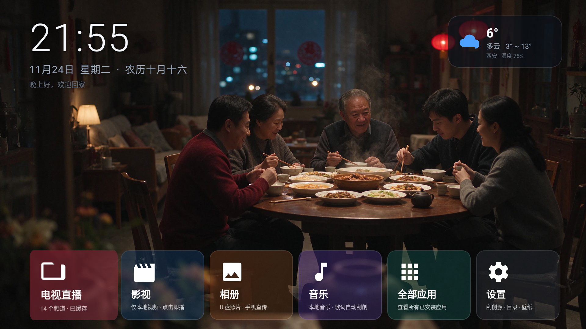

# 智慧家庭TV · Android 8 电视桌面

面向 Android 8（API 26）电视盒子 / 智能电视的桌面与本地媒体中心：顶部大时钟、农历日期与按定位获取的天气，6 张功能卡进入本地直播、影视、相册、音乐、全部应用与设置；配套儿童答题锁屏与家长管控（设置需密码、闲置自动出题、开机锁定、无障碍守护），以及看本地媒体的播放能力。

> 布局参考 [pengchujin/aerial-tv](https://github.com/pengchujin/aerial-tv) 的卡片式大屏风格：深色渐变、时钟 + 天气、单个功能卡行，背景支持视频或图片（默认内置「阖家团圆」图）。当前首页只有 6 张功能卡，**不再有「常用与收藏」网站/应用横排**。



## 功能一览

| 模块 | 实现要点 |
| --- | --- |
| 桌面 | 大时钟、日期 + 农历、按时段问候语；右上角天气（Open-Meteo，定位优先，结果本地缓存）；6 张入口卡“电视直播 / 影视 / 相册 / 音乐 / 全部应用 / 设置”；背景为内置团圆图，可在设置里指定视频或在相册里把照片设为壁纸；遥控器焦点放大 + 高亮描边 |
| 电视直播 | 读取「设置 → 直播源」的 m3u / m3u8 地址或本地路径，同时自动发现各存储卷 `Download` 目录下的 `.m3u` / `.m3u8`；解析 `#EXTINF`、`group-title`、`tvg-logo`、`#EXTGRP`；按「央视 → 卫视 → 地方 → 其他」分组展示，支持收藏频道与右上角刷新；频道信息写入本地缓存，台标下载到 `files/live_logos/<sha1>.img`（最多 400 个、单个 4MB），断网时先出缓存；点频道直接全屏播放 |
| 影视 | 只扫描本地视频，4 列海报墙；标题 / 年份 / 季集由文件名解析（`SxxExx`、`第N季第N集` 等）；海报优先取同目录同名图或 `poster/folder/cover`，没有则播放器抽帧；角标按分辨率显示 4K / 1080P / 720P；点击海报直接全屏播放，长按或菜单键删除 |
| 相册 | 全盘图片 6 列网格，按拍摄日期倒序分组并显示「日期 + 星期 + 张数」；拍摄时间依次取 EXIF `DateTimeOriginal` / `DateTime` / `DateTimeDigitized` → 文件名日期 → 文件修改时间；网格内菜单键或长按删除；全屏查看用方向键平移、OK 键缩放，菜单键或长按 OK 可把当前照片设为桌面壁纸；右上角进入手机上传页 |
| 音乐 | 扫描内置存储与所有外接盘（可配自定义目录），支持 mp3 / flac / m4a / aac / ogg / opus / wav / wma / mka / ape；ExoPlayer 播放 + 前台服务与通知栏控制；读取标签与内嵌封面（读不到时按「艺术家 - 标题」解析文件名）；自定义歌单（新建 / 重命名 / 删除 / 长按加歌 / 从歌单移除）；顺序 / 随机播放切换并持久化；LRC 歌词自动刮削并按时间轴高亮居中滚动 |
| 全部应用 | 读取已安装的可启动应用，网格列数 4 / 5 / 6 可调 |
| 手机上传 | 页面内嵌 NanoHTTPD 服务（默认端口 `8686`，被占用自动 +1 重试，最多试 6 次），进入页面即启动；手机浏览器打开 `http://电视IP:端口` 多选照片 / 视频逐个上传；写入 U 盘 `Photos`（未插 U 盘时落到应用外部目录），重名自动加 `(1)`；单文件上限 300MB，仅接受图片与视频后缀 |
| 浏览器 | WebView 地址栏、返回（网页后退）、收藏当前网页、下载直链；`thunder://` 自动 Base64 解码并去掉 `AA` / `ZZ` 包装后交给系统 DownloadManager，落到公共 Download 目录；磁力链接提示不支持 |
| 智慧锁屏 | 闲置到设定时间自动全屏出题，答对才回桌面；题库 924 题、16 档难度（学前 / 小班 / 中班 / 大班 / 一至九年级 / 高一至高三）；选择题乱序选项、填空题数字键盘；答错自动换一题；家长 4 位密码可直接解锁 |
| 家长管控 | 进入「设置」前必须验证家长密码（默认 `1234`）；可开关锁定、设开机锁定、设自动锁屏时长（含“不自动锁”）；启用无障碍服务后锁定时拦截 Home / 最近任务，切到其他应用会重新盖上答题页；设备所有者模式下额外启用锁任务（kiosk） |
| 开机与守护 | `BOOT_COMPLETED` 等广播拉起桌面或答题页，并按开机窗口调度兜底闹钟重试；Activity 前后台切换时每 15 秒检查一次闲置计时，避免锁屏页被 Home 键绕过 |

## 技术栈

- Kotlin 2.0.21，AGP 8.7.3，Gradle 8.9（wrapper 指向腾讯云镜像），Java 17 字节码
- `compileSdk 34`，`minSdk 26`，`targetSdk 28`（使用 Android 8 的存储与后台行为）
- 依赖：androidx.core、androidx.recyclerview、androidx.media3（exoplayer / hls / datasource-okhttp / ui）、androidx.exifinterface、OkHttp、NanoHTTPD
- 无 AppCompat / Compose / Glide / Coil / 协程；图片加载、线程池、歌词解析均自带实现
- ViewBinding + 平台 `Theme.Material.NoActionBar`；`applicationId = com.mytv.launcher`

## 构建

环境要求：JDK 17+、Android SDK Platform 34、Build-Tools 34.0.0。

```powershell
# SDK 路径写在 local.properties（该文件不入库）
# sdk.dir=C:\\Users\\<你>\\AppData\\Local\\Android\\Sdk

$env:JAVA_HOME = "C:\Users\liuji\.jdks\jbr-21.0.11"   # AGP 8.x 不接受 JDK 8

.\gradlew.bat assembleDebug      # 产物：app\build\outputs\apk\debug\app-debug.apk
.\gradlew.bat assembleTvapp      # 产物：app\build\outputs\apk\tvapp\app-tvapp.apk
```

仓库只保存源码与构建脚本，APK 与构建目录已在 `.gitignore` 中排除，不随仓库分发。

安装到电视（ADB 调试已开启）：

```powershell
adb connect 电视IP:5555
adb install -r app-debug.apk
```

### TCL / 雷鸟电视：只能作为普通应用安装

部分 TCL 固件在解析 APK 时拒绝非 TCL 签名的桌面应用：

```
INSTALL_PARSE_FAILED_INCONSISTENT_CERTIFICATES: disable install launcher app not signature by tcl
```

仓库提供去掉 `CATEGORY_HOME` 的 `tvapp` 变体（源码见 `app/src/tvapp/AndroidManifest.xml`）：

```powershell
.\gradlew.bat assembleTvapp
adb install -r app-tvapp.apk
```

- 包名 `com.mytv.launcher.tvapp`，版本名 `1.3.0-tvapp`，显示名称仍是「智慧家庭TV」；
- 可从电视「全部应用」手动打开，功能完整（含锁屏与上传）；
- 不能设为默认桌面，按 Home 仍回电视自带桌面；设置里的「开机进入 智慧家庭TV」会提示当前安装包没有桌面入口。

## 首次使用

1. 打开应用，授予「存储」与「位置」权限（位置只用于天气城市）。
2. 设为默认桌面：电视「设置 → 应用 → 默认应用 → 主屏幕」选择「智慧家庭TV」，或
   ```powershell
   adb shell cmd package set-home-activity com.mytv.launcher/.ui.MainActivity
   ```
3. 首页天气默认自动定位：先取系统最后已知位置并反查城市，失败再走 IP 定位；都失败回退手动城市「西安」，坐标可在设置里改。

## 各模块说明

### 电视直播

- 直播源一行填一个 m3u / m3u8 地址或本地文件路径；`Download` 目录里的源会自动合并进来，无需手动添加。
- 进入后先渲染本地缓存再后台刷新；刷新失败保留上一次缓存。
- 频道列表带分组标题与数量，源里常见的「点播」「非直链」「失效源」会在卡片上标注，便于挑可播的频道。
- 播放走 ExoPlayer：`.m3u8` 用 HLS，`.flv` 显式挂 `FlvExtractor`；非直链地址先跟随重定向解析 Content-Type 再决定播放或回退 WebView；斗鱼 / 虎牙链接自动补 Referer；断流会自动重试，超过次数提示换台。
- 暂不支持 `rtmp://` / `rtsp://`（未引入对应扩展），这类频道能列出但播放会失败。

### 影视

- 只扫本地视频，点击海报直接全屏播放，不再进详情页、不再询问播放器。
- 字幕：同目录同名 `.srt` / `.ass` / `.ssa` / `.vtt` 自动挂载。
- 解码：ExoPlayer 默认优先系统硬解（MediaCodec / Codec2），开启 `setEnableDecoderFallback(true)`，硬解失败自动回退软解。
- 说明：`VideoDetailActivity` 与 `VideoScraper.enrich`（NFO / TMDB 刮削）代码仍在，但影视库当前不再跳详情页，所以 **设置里的 TMDB Key 与「清除刮削缓存」不影响影视库展示**；海报来自同目录图片或视频抽帧。

### 音乐

- 自动扫描所有存储卷，也可在「设置 → 音乐目录」填 `;` 分隔的目录。
- 歌单：顶部「我的歌单」列表，新建 / 长按重命名或删除；「全部歌曲」中长按歌曲加入歌单，歌单内长按可从歌单移除（不会删文件）。
- 播放模式按钮在「顺序播放 / 随机播放」间切换，状态存 `play_mode`。
- 歌词顺序：同目录同名 `.lrc` 或 `lyrics/<同名>.lrc` → 已刮削缓存 `files/lyrics/<hash>.lrc` → 网易云音乐搜索接口 → LRCLIB；都失败时提示可手动放 `.lrc`。
- 内嵌封面写到 `files/artwork/<md5>.img` 复用，列表与通知栏共用。

### 相册 / 手机上传

- 日期分组标题形如「2023年5月4日 星期四 · 1 张」，按拍摄日期倒序。
- 手机上传：电视与手机连同一 WiFi，相册页点「手机上传」，手机打开页面上的 `http://电视IP:8686`，可一次多选照片与视频；上传完成自动刷新相册。
- 支持后缀：jpg / jpeg / png / gif / webp / bmp / heic / heif / mp4 / mov / 3gp / m4v；单文件 ≤ 300MB。

### 浏览器

- 入口在「设置 → 网页浏览器」；输入域名会自动补 `https://`。
- 收藏 / 取消收藏保存在本地 `bookmarks`（JSON），仅在浏览器内显示状态，**首页不再展示网站磁贴**。
- 下载支持 http(s) 直链与 `thunder://`；网页内触发的下载会先弹确认，blob / data 链接提示不支持。

### 智慧锁屏与家长管控

- 「设置 → 智慧锁屏」开启后，桌面闲置到设定时间（默认 30 分钟）自动拉起全屏答题页；「开机自动锁定」默认开启，开机先答题再进桌面。
- 难度可选 16 档，题库按 `grades` 字段筛题；选择题选项每次乱序；填空题按题目 `numeric` 标记分两种：数值题用屏幕数字键盘，文字题用输入框；答错提示后自动换题，并排除刚答错的题。
- 答不出时点「家长解锁」输入 4 位密码（默认 `1234`，可在设置改）直接解锁。
- 「全系统锁屏守护」需在电视「设置 → 无障碍」里开启「智慧家庭TV」；服务只拦截 Home / 最近任务并在锁定时重新盖上答题页，不读取屏幕内容、不模拟点击。
- 设备所有者（device owner）模式下会额外设置锁任务白名单、禁用状态栏与锁屏密码页；非 owner 设备自动跳过这些策略。
- 题库来源：CMATH（MIT）600 题、C-Eval（CC BY-NC-SA 4.0）284 题、自编启蒙题 40 题；共 924 题（选择题 510 / 填空题 414），含 2 道图片题与 1 道视频题（`res/raw/lock_count.mp4`）。仅用于家庭非商业场景，公开分发前请自行核对上游许可。

## 设置项

进入「设置」前需输入家长密码。全部存于 `SharedPreferences("mytv_prefs")`，修改即时生效：

| 项 | 说明 | 默认 |
| --- | --- | --- |
| `loc_auto` / `loc_at` | 天气自动定位开关 / 上次定位时间 | true / 0 |
| `city` / `lat` / `lon` | 城市名与坐标 | 西安 / 34.3416 / 108.9398 |
| `tmdb_key` | TMDB v3 API Key（当前影视库未使用） | 空 |
| `music_dirs` / `video_dirs` | 扫描目录，`;` 分隔 | 空（全盘扫描） |
| `live_sources` | 直播源，一行一个 | 空（自动扫 Download） |
| `live_channels` / `live_channels_at` | 频道缓存 JSON / 缓存时间 | `[]` / 0 |
| `live_favorites` | 收藏频道 JSON | `[]` |
| `photo_dir` | 相册 / 上传目标目录 | 空（U 盘 Photos） |
| `upload_port` | 上传服务端口 | 8686 |
| `wallpaper` / `wallpaper_image` | 桌面背景视频路径 / 图片路径（互斥，设置任一项会清另一项） | 空（内置团圆图） |
| `columns` | 全部应用每行列数 | 5（4–6） |
| `play_mode` | `seq` 顺序 / `shuffle` 随机 | seq |
| `playlists` | 自定义歌单 JSON | `[]` |
| `bookmarks` | 浏览器收藏 JSON | `[]` |
| `lock_enabled` | 智慧锁屏开关 | false |
| `lock_timeout_min` | 自动锁屏分钟数，0 为不自动锁 | 30 |
| `lock_difficulty` | 解锁难度 | 一年级 |
| `lock_pin` | 家长 4 位密码 | 1234 |
| `lock_on_boot` | 开机立即锁定 | true |
| `jptv_pkg` | JPTV 包名（安装包页使用） | tv.android.jianpian.com |

## 代码结构

```
app/src/main/java/com/mytv/launcher/
├── App.kt / Prefs.kt          应用入口、闲置锁屏计时、SharedPreferences 封装
├── admin/                     设备管理员接收器（kiosk 策略用）
├── launcher/                  已安装应用列表与启动；JPTV 安装包辅助
├── lock/                      锁屏状态、闲置计时、题库、无障碍守护、开机广播、kiosk
├── media/                     媒体扫描、封面与图片加载、歌词、m3u 解析、直播缓存、歌单、文件名解析
├── model/Models.kt            AudioTrack / VideoItem / PhotoItem / LiveChannel / Playlist 等
├── player/                    音乐 ExoPlayer 单例、前台服务、通知栏按钮
├── server/UploadServer.kt     NanoHTTPD 上传页与原始字节落盘
├── ui/                        桌面、直播、影视、播放器、相册、音乐、全部应用、浏览器、上传、设置、锁屏
├── util/                      线程池、存储卷与扫描、通用 UI 工具
├── weather/                   Open-Meteo 天气、系统 / IP 定位
└── web/                       收藏 JSON、thunder:// 解码与下载

app/src/main/assets/lockscreen/  questions.json + 图片题素材
app/src/main/res/raw/            lock_count.mp4（视频题）
app/src/tvapp/AndroidManifest.xml 去掉 HOME 类别的 tvapp 变体
```

## 自测清单

构建与安装通过后，建议在目标电视上确认：

1. `assembleDebug` / `assembleTvapp` 均可产出 APK，安装后能设为默认桌面（或被 TCL 拒装时改用 tvapp）。
2. 首页时钟、农历、天气（定位授权后）与 6 张卡正常；遥控器 D-pad 焦点移动顺畅。
3. 直播：放入一个 m3u 后频道墙分组正确、台标缓存、点频道可播；断网重进仍显示缓存。
4. 影视：U 盘里的视频被扫描到，点海报直接播放，同目录字幕能显示。
5. 相册：EXIF 日期分组正确，全屏可缩放；手机上传页面可打开并上传成功。
6. 音乐：歌单增删、顺序 / 随机切换、歌词高亮滚动、通知栏上一首 / 下一首可用。
7. 锁屏：开启后闲置到点出题，答对回桌面，答错换题，家长密码可解锁；开启无障碍后按 Home 无法绕过。

## 已知限制

- 目标运行环境为 Android 8；Android 11+ 的分区存储会限制直接写 U 盘目录，本项目按 `targetSdk 28` 使用旧存储模型。
- TCL / 雷鸟等固件拒绝非本厂签名的桌面 APK，只能安装 `tvapp` 变体作为普通应用。
- `rtmp://` / `rtsp://` 未集成 ExoPlayer 扩展；部分源把网页地址当频道 URL，播放会停在黑屏，优先选 m3u8 直链。
- 影视库已去掉详情页入口，`VideoDetailActivity` 与 TMDB / NFO 刮削代码保留但不再被影视库调用。
- 浏览器收藏只保存在本地，首页已不展示收藏磁贴；`magnet:` 磁力链接不支持。
- JPTV 安装包页（`DownloadActivity`）代码保留，但当前设置里没有入口。
- IP 定位为城市级精度，且依赖第三方免费接口；接口不可达时回退手动城市。
- 下载交给系统 DownloadManager，落到公共 `Download` 目录；部分高版本设备的下载中心不显示已入队任务。
- 网易云歌词接口为非官方接口，可能失效，失败会回退 LRCLIB 与本地 LRC。
- 未集成字幕在线下载、媒体库分卷 / 合集自动归类、海报手动更换。

## 许可证

MIT，见仓库根目录 `LICENSE`。题库素材另有来源许可，见上文「智慧锁屏与家长管控」。
